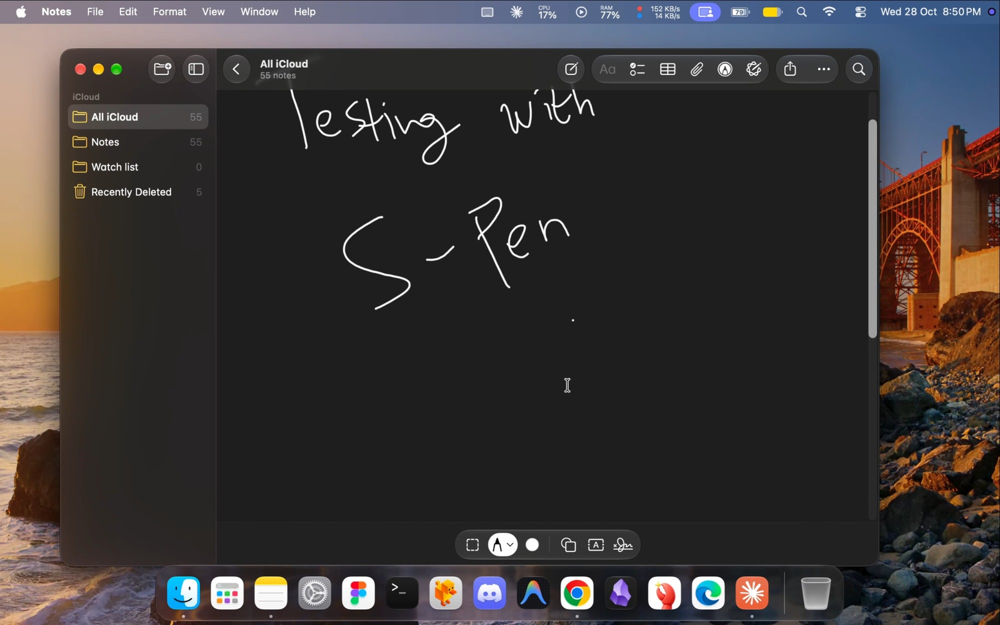
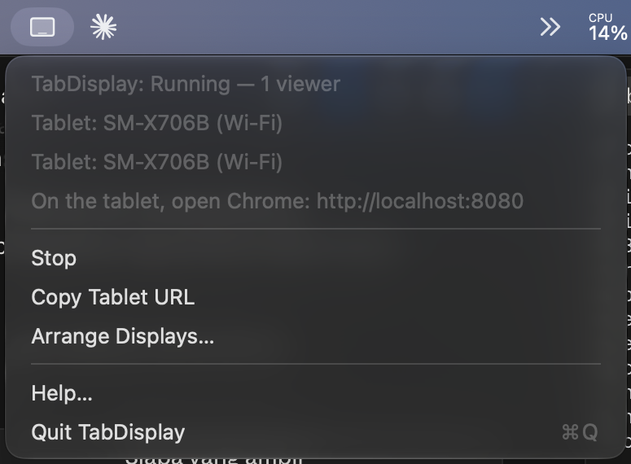
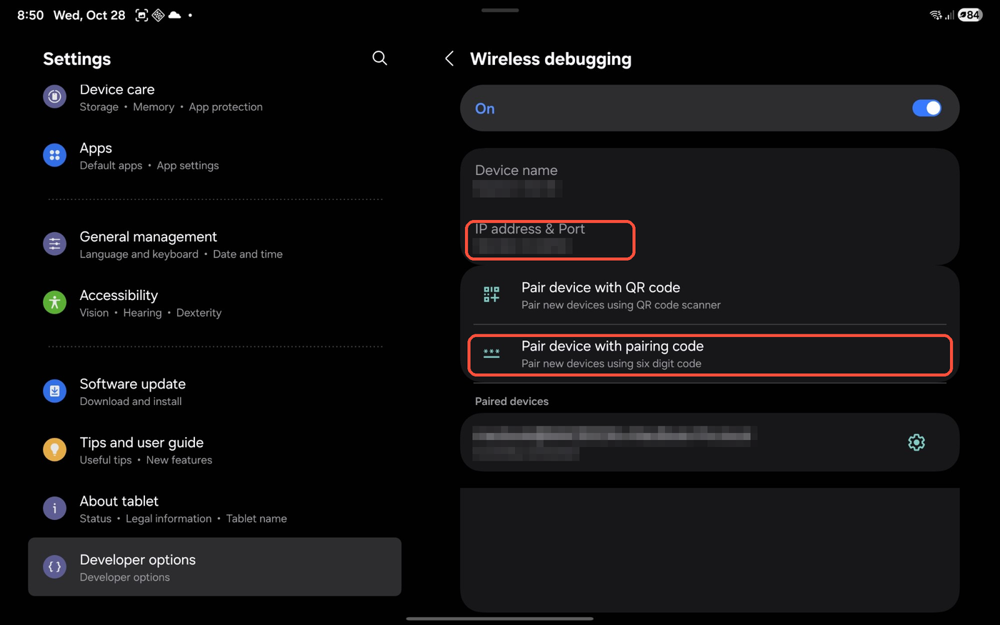
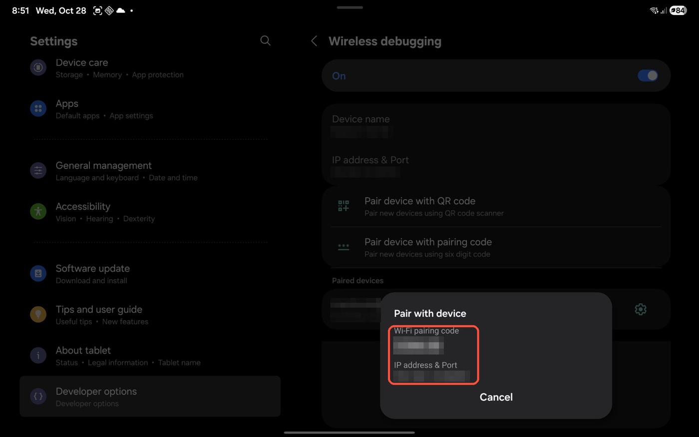

# TabDisplay

[English](README.md) · **Bahasa Indonesia**

Jadikan tablet Android sebagai layar tambahan untuk Mac, seperti Sidecar tapi untuk Android. Tablet nggak perlu install app apa pun, cukup Chrome.

- Memperluas desktop (bukan sekadar mirror) di 2560×1600 HiDPI, 60 fps, H.264 hardware
- Sentuhan, S Pen, serta keyboard dan mouse dikirim balik ke Mac
- Portrait atau landscape mengikuti posisi tablet
- Lewat kabel USB, atau Wi-Fi dengan wireless debugging
- Berjalan dari menu bar



Sudah diuji di Galaxy Tab S8 (Android 16, Chrome 156) dengan macOS 27 di Apple Silicon. Perangkat Android lain dengan Chrome versi baru seharusnya juga bisa.

## Cara kerjanya

```
Mac (TabDisplay.app)                                           Tablet Android (Chrome)
layar virtual → ScreenCaptureKit → VideoToolbox H.264 → WebSocket ═adb═▶ WebCodecs → <canvas>
      ▲                                                                        │
      └──────────────── CGEvent mouse/scroll ◀──── sentuhan / S Pen ───────────┘
```

1. **Layar virtual.** API private macOS `CGVirtualDisplay` membuat monitor yang dianggap nyata oleh macOS. Cara ini juga dipakai BetterDisplay dan tool sejenis.
2. **Rekam dan encode.** ScreenCaptureKit merekam layar itu, lalu VideoToolbox meng-encode-nya pakai H.264 hardware dalam mode jeda rendah.
3. **Pengiriman.** Server kecil di `127.0.0.1` menyajikan halaman viewer (port 8080) dan mengalirkan frame lewat WebSocket (port 8081). `adb reverse` memetakan port itu ke `localhost` milik tablet.
4. **Decode.** WebCodecs di Chrome men-decode H.264 pakai hardware lalu menggambarnya di canvas. WebCodecs cuma aktif di origin yang aman, dan `localhost` termasuk. Karena itu tablet membuka `http://localhost:8080`, bukan IP Mac.
5. **Input.** Sentuhan dikirim balik lewat WebSocket yang sama, lalu diubah jadi event mouse di layar virtual.

## Kebutuhan

- macOS 14 Sonoma atau lebih baru
- Tablet atau HP Android dengan Chrome
- Kabel USB data, atau Mac dan tablet di jaringan Wi-Fi yang sama
- `adb` dari Homebrew:
  ```bash
  brew install android-platform-tools
  ```

## Instalasi

### Opsi A: download app

1. Download `TabDisplay-x.y.z.dmg` dari [Releases](https://github.com/seppam/TabDisplay/releases).
2. Buka DMG-nya, lalu drag **TabDisplay** ke **Applications**.
3. Buka TabDisplay. Pertama kali dibuka, macOS akan memblokirnya (lihat bagian berikut).

#### "TabDisplay can't be opened" (Gatekeeper)

TabDisplay gratis dan open source, dan nggak ditandatangani dengan Apple Developer ID berbayar, jadi macOS nggak bisa memverifikasi pembuatnya. Ini wajar untuk app Mac open source kecil. Ada dua cara untuk mengizinkannya:

- **Lewat System Settings:** coba buka app-nya sekali, lalu masuk ke **System Settings → Privacy & Security**. Scroll ke pesan tentang TabDisplay, klik **Open Anyway**, lalu konfirmasi.
- **Lewat Terminal:** hapus tanda karantina hasil download:
  ```bash
  xattr -dr com.apple.quarantine /Applications/TabDisplay.app
  ```

Kalau kamu nggak mau memercayai binary hasil download, build sendiri saja (Opsi B). Seluruh app-nya cuma beberapa ratus baris Swift.

### Opsi B: build dari source

Butuh Xcode atau Xcode Command Line Tools.

```bash
git clone https://github.com/seppam/TabDisplay.git
cd TabDisplay
swift run -c release
```

Perintah ini menjalankan app menu bar langsung dari Terminal. Dalam mode ini, macOS meminta izin untuk **Terminal**, bukan untuk TabDisplay.

Untuk membuat `.app` dan `.dmg` sendiri ke folder `dist/`:

```bash
packaging/build-app.sh 1.0.0
```

## Setup

### 1. Di tablet: izinkan USB debugging (sekali saja)

1. **Settings → About tablet → Software information**, lalu ketuk **Build number** 7 kali untuk mengaktifkan Developer options.
2. **Settings → Developer options**, lalu nyalakan **USB debugging**.
3. Colok tablet ke Mac pakai kabel USB. Kalau tablet bertanya mode USB, pilih **Transferring files**.
4. Waktu muncul **Allow USB debugging?**, centang *Always allow from this computer*, lalu ketuk **Allow**.

Kalau prompt-nya nggak muncul, matikan dan nyalakan lagi USB debugging, lalu colok ulang kabelnya. Colok langsung ke Mac, jangan lewat hub, dan coba kabel lain. Ada kabel yang cuma bisa untuk cas.

### 2. Di Mac: berikan izin (sekali saja)

Waktu TabDisplay pertama kali jalan, macOS meminta dua izin di **System Settings → Privacy & Security**:

| Izin | Untuk apa | Kalau nggak diberikan |
|---|---|---|
| **Screen Recording** (bisa bernama *Screen & System Audio Recording*) | Merekam layar virtual | Nggak ada gambar yang dikirim. Setelah memberi izin, **quit lalu buka lagi** TabDisplay. |
| **Accessibility** | Mengubah sentuhan jadi klik mouse | Gambar tampil, tapi sentuhan nggak berpengaruh |

> **Setelah update TabDisplay**, macOS bisa menganggap versi baru sebagai app yang berbeda, karena app-nya nggak ditandatangani Developer ID. Kalau sentuhan atau video berhenti bekerja setelah update, hapus TabDisplay dari kedua daftar izin dengan tombol **−**, lalu tambahkan lagi.

### 3. Sambungkan

1. Buka TabDisplay. Ikon berbentuk iPad muncul di menu bar, dan menunya menampilkan nama tablet kamu.

   

2. Di tablet, buka Chrome lalu masuk ke **`http://localhost:8080`**.
3. **Ketuk sekali** untuk masuk layar penuh. Ketukan pertama itu nggak dikirim ke Mac.
4. Di Mac, buka **menu TabDisplay → Arrange Displays…**, lalu geser layarnya sesuai posisi tablet di meja.

## Gesture

| Di tablet | Di Mac |
|---|---|
| Ketuk | Klik |
| Sentuh lalu geser | Klik dan drag |
| Sentuh dan tahan (½ detik) | Klik kanan |
| Geser dua jari | Scroll |
| Ketuk tepi bawah, atau tap tiga jari | Munculkan Dock (kalau Dock disembunyikan otomatis) |
| Hover S Pen | Gerakkan kursor |
| S Pen sambil menekan tombol samping | Klik kanan |
| Putar tablet | Layar berganti portrait atau landscape |

Keyboard dan mouse yang tersambung ke Mac bisa dipakai di layar tablet seperti di monitor biasa.

## Lewat Wi-Fi

`adb reverse` juga bekerja lewat wireless debugging, jadi tablet tetap membuka `localhost`.

1. Pastikan Mac dan tablet ada di jaringan Wi-Fi yang sama.
2. Di tablet, buka **Developer options → Wireless debugging**, nyalakan, lalu ketuk **Pair device with pairing code**.

   

3. Di Mac, pair pakai **IP address & port** yang tampil di popup pairing, lalu ketik **pairing code** 6 digit saat diminta:

   

   ```bash
   adb pair <ip-tablet>:<port-pairing>
   ```
   Contoh: `adb pair 192.168.1.23:37451`. Pakai angka dari tablet kamu sendiri.
4. Tutup popup-nya. Layar utama **Wireless debugging** menampilkan **IP address & port** yang lain. Port di sini *berbeda* dari port pairing. Sambungkan pakai port ini:
   ```bash
   adb connect <ip-tablet>:<port-connect>
   ```
   Contoh: `adb connect 192.168.1.23:41023`.
5. Cabut kabel USB. TabDisplay akan menemukan koneksi wireless dalam beberapa detik.

Wi-Fi menambah jeda dan tergantung kualitas jaringan. Paling bagus pakai Wi-Fi 5 GHz yang dekat dengan router. Pairing-nya diingat, tapi port connect berubah setiap wireless debugging dinyalakan ulang. Kalau itu terjadi, ulangi langkah 4.

## Troubleshooting

| Masalah | Solusi |
|---|---|
| Menu menampilkan **adb not found** | `brew install android-platform-tools`, lalu buka ulang TabDisplay |
| Menu menampilkan **No tablet** | Pastikan USB debugging sudah diizinkan di tablet. `adb devices` harus menampilkan tablet dengan status `device`, bukan `unauthorized`. |
| Halaman menampilkan **WebCodecs tidak tersedia** | Kamu membuka IP Mac. Pakai `http://localhost:8080`. |
| Halaman terbuka tapi tetap hitam | Berikan izin **Screen Recording**, lalu quit dan buka lagi TabDisplay |
| Video jalan, sentuhan nggak | Berikan izin **Accessibility** (atau hapus lalu tambahkan lagi setelah update) |
| **Port 8080 is unavailable** | Ada TabDisplay lain, atau app lain yang memakai port itu, sedang jalan. Tutup dulu. |
| Layar tablet mati sendiri | Halaman menjaga layar tetap menyala selama tampil. Sebagai cadangan, nyalakan **Developer options → Stay awake**. |
| Patah-patah lewat Wi-Fi | Mendekat ke router, pakai 5 GHz, atau pakai USB |

## Keterbatasan

- **API private.** `CGVirtualDisplay` nggak didokumentasikan, dan bisa rusak setelah update macOS.
- **Cuma mouse, belum multi-touch.** macOS nggak mendukung layar sentuh, jadi sentuhan diubah jadi event mouse dan scroll. Pinch-zoom, rotasi, dan tekanan pena belum diteruskan.
- **Cuma Chrome.** Browser lain mungkin belum punya decoder H.264 WebCodecs.
- **Satu resolusi**, 1280×800 point (2560×1600 piksel).

## Roadmap

- Pinch untuk zoom dan gesture trackpad lain
- Pengaturan resolusi dan bitrate di menu
- Jalan otomatis saat login

## Keamanan

Server cuma mendengarkan di `127.0.0.1`, jadi perangkat lain di jaringan kamu nggak bisa melihat layar atau mengirim input. Cuma perangkat yang tersambung lewat `adb` milikmu sendiri yang bisa mengaksesnya.

## Lisensi

[MIT](LICENSE). TabDisplay nggak berafiliasi dengan Apple, Samsung, atau Google.
